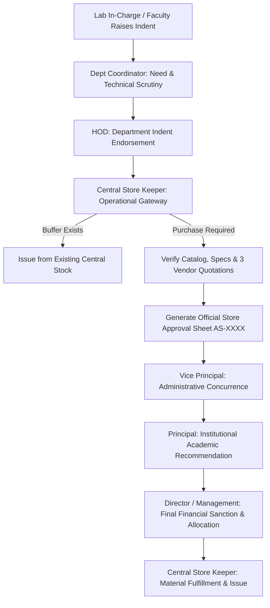

# MSEC SMART STOCK — UI & Workflow Documentation
**Mohamed Sathak Engineering College (Autonomous), Kilakarai**  
*Institutional Inventory, Asset, Procurement, Distribution, Transfer, Approval, Audit & Compliance Portal*

---

## 1. Executive Summary & Design System

### 1.1 Overview
**MSEC SMART STOCK** is an enterprise-grade ERP portal designed for engineering institutions. It unifies college-wide inventory management, asset custody tracking, multi-tier requisition workflows, Store Keeper operational verification, comparative vendor quotations, Purchase Order (PO) issuance, Goods Receipt Note (GRN) quality inspections, inter-departmental transfers, repair bay tracking, annual departmental budgets, and NAAC/NBA statutory compliance reporting.

### 1.2 Design Philosophy & Aesthetics
- **Color Palette**:
  - Primary Dark Navy: `#102a43` / `#17365d` (Header, Brand Badges, Letterheads)
  - Accent Institutional Blue: `#2563eb` / `#1d4ed8` (Active Actions, Primary Buttons)
  - Neutral Background: `#f4f7fb` (Subtle off-white contrast against cards)
  - Status Indicators: Emerald Green (`#15803d`), Amber Yellow (`#b45309`), Crimson Red (`#b91c1c`), Indigo Purple (`#4338ca`)
- **Typography**: Inter / Outfit modern sans-serif typography with strict hierarchy (`h1`-`h4`, micro-labels, uppercase section trackers).
- **Glassmorphism & Micro-Interactions**: Subtle shadows (`box-shadow: 0 4px 6px -1px rgba(0,0,0,0.05)`), smooth pill tabs, sticky table headers, touch-friendly scrollable filters, and interactive modals.
- **Print Media Optimization**: Full `@media print` stylesheets across official institutional documents, hiding screen navigation, rendering crisp college letterhead banners (`images/msec_letterhead.png`), barcoding fonts, and formal multi-tier signature blocks.

---

## 2. Institutional Authentication & Security Policy

### 2.1 Zero Public Self-Registration
- **Policy**: Public registration is completely prohibited. There is **no** "Create Account" or "Sign Up" button on the login screen.
- **Provisioning**: User accounts are created exclusively by the **System Administrator** via `index.php?route=admin_users`.
- **Identity Fields**: Username, institutional email (`@msec.org.in`), employee ID (`EMP-XXXX`), designation, assigned role, department, and laboratory mapping.

### 2.2 Strict Admin-Only Password Reset Protocol
- **Policy**: In accordance with college governance, there is **no** self-service "Forgot Password?" email or OTP reset option on the login portal.
- **Protocol**: If a user forgets their password, they must contact the System Administrator. The Administrator verifies employee identity in person, performs an authenticated reset via the administrative console (`admin_users`), and the event is permanently logged into the immutable audit trail (`audit_logs`) with IP address, timestamp, and Admin ID.

### 2.3 Bruteforce Auto-Locking
- The portal enforces account locking after **5 consecutive failed attempts**.
- Accounts remain locked until explicitly unlocked by the System Administrator with an audit justification memo.

### 2.4 Multi-Department & Role-First Authentication Portal (`views/auth/login.php`)
- **Institutional Brand Architecture**: College crest, autonomous designation, NAAC 'A+' accreditation pill, and SSL verification.
- **Section Navigation Tabs**:
  1. `🎓 Academic & Labs` (CSE, IT, AI&DS, ECE, EEE, MECH, CIVIL, Central Library, Incubation Hub).
  2. `🏬 Stores & Purchase` (Central Store Keeper, Purchase Officer, Chief Accounts Officer).
  3. `🏛️ Directorate` (Director, Principal, Vice Principal, Management Viewer).
  4. `🛡️ Admin & Audit` (Super Administrator, Internal & NAAC Auditor).
- **Context-Aware Dynamic Login Console**: Selecting any personnel or role card immediately updates the login console with their departmental scope, designation, authority ceiling, and pre-populates official credentials for direct evaluation. Manual credentials can also be typed anytime.
- **Mobile Native Web App (iOS & Android)**:
  - **iOS Safari Optimizations**: `viewport-fit=cover`, Apple touch icons, full safe-area insets (`env(safe-area-inset-top)` / `bottom`) to avoid notch and Home Indicator collisions, and `font-size: 16px !important;` on form controls to eliminate Safari's viewport zoom bug.
  - **Android Chrome Optimizations**: Theme color headers, Material touch manipulation with `-webkit-tap-highlight-color: transparent`, and zero tap delay.
  - **Mobile Segmented Switcher**: Sticky segmented navigation bar (`[1. Select Role]` / `[2. Sign In]`) with live role status badge on screens `<= 960px`.
  - **Floating Thumb Action Pill**: Sticky bottom card showing the active persona with an instant `Sign In ⚡` action button within natural one-handed reach.

---

## 3. The 14 Role Workspaces & Dashboards

Each role in MSEC SMART STOCK features a tailored dashboard with specific key performance indicators (KPIs), operational action queues, and permission gates.

| Role Key | Institutional Role | Primary Responsibilities |
|---|---|---|
| `super_admin` / `admin` | System Administrator | User provisioning, credential resets, account locking, audit trail, security threat logs, system parameters |
| `director` | Directorate Executive | **Ultimate Financial Sanctioning Authority**, institutional valuation, capital allocations, Trust governance |
| `principal` | Principal | Institutional academic review & recommendation to Management, compliance audit sign-offs |
| `vice_principal` | Vice Principal | Administrative review & concurrence, inter-department transfers, stock adjustments |
| `store_keeper` | Central Store Keeper | **Mandatory Operational Gateway**, existing stock verification, spec checking, quotation review, Approval Sheet generation, dispatch vouchers |
| `purchase_officer` | Purchase Officer | Empaneled vendors, 3-quote rule, comparative quotation matrix, L1 selection, Purchase Order (PO) issuance |
| `accounts_officer` | Accounts Officer | Department budget head monitoring, capital/operational fund commitment, financial clearance |
| `hod` | Head of Department (HOD) | Department indent endorsement, lab indent review, quota allocation (no independent financial sanction) |
| `dept_coordinator` | Department Coordinator | Technical spec verification, lab item inspections, store voucher receipt acknowledgment |
| `lab_incharge` | Laboratory In-Charge | Lab terminal custody, legacy equipment onboarding (approx costs, no GST bills required), consumable indents, physical damage and fault reporting |
| `technician` | Laboratory Technician | Repair bay workbench, fault diagnosis, SMPS/RAM replacements, repair costs, spares indents |
| `auditor` | Statutory & Internal Auditor | Quarterly/Annual stock counts, physical vs system variance, dead stock watchlist, immutable ledger inspection |
| `management_viewer` | Management Viewer | Read-only governance analytics, department stock trends, NAAC/NBA compliance overview |

---

## 4. Key Workflows & Operational Life Cycles

### 4.1 The Institutional Approval Workflow & Operational Gateway
No purchase request bypasses the Central Store Keeper, regardless of monetary value. Department heads endorse indents, while ultimate financial sanction rests exclusively with Management (Directorate).

### 4.2 Official Store Keeper Approval Sheet (`approval_sheets/view.php`)
- Generated by the Store Keeper upon completing physical inventory checks.
- Contains:
  1. Header banner with College Seal and NAAC A+ / NBA autonomous badges.
  2. Summary of existing central stock (e.g. "Zero buffer in central; immediate procurement necessary").
  3. Technical specification verification notes.
  4. Selected vendor quote, base price, GST % (18%), and total landed cost.
  5. 4 official signature blocks: HOD, Store Keeper, Vice Principal, and Principal.

### 4.3 Procurement, PO & GRN Inward Flow (`procurement/index.php`)
- **Quotation Comparison Statement**: Compares multiple vendor quotes (Rate, GST, Delivery period, Warranty, Rating) and highlights the lowest quoted **L1 Recommendation**.
- **Purchase Order (PO)**: Generates printable official PO with college terms & conditions, payment milestones, delivery schedule, and 3-party signatures (`views/procurement/po.php`).
- **Goods Receipt Note (GRN)**: Store Keeper performs physical delivery inspection, enters accepted and rejected quantities, logs quality notes, and triggers automatic credit to central stock balances.

### 4.4 Stock Distribution & Delivery Vouchers (`distribution/index.php`)
- Central Store Keeper generates formal Store Issue Vouchers or Delivery Challans.
- Dispatched items update the departmental custody register.
- The recipient Department Coordinator physically checks materials and submits a digital acknowledgment (`views/distribution/voucher.php`), printing a 3-party signed voucher.

### 4.5 Inter-Department Transfers (`movement/index.php`)
- Handles scenarios such as: *CSE has 10 surplus keyboards, and ECE requires 5 units.*
- Lifecycle: `Submitted` &rarr; `Store Keeper Approved` &rarr; `Dispatched (In Transit)` &rarr; `Acknowledged & Closed`.

### 4.6 IT Asset Custody & Maintenance (`assets/index.php` & `maintenance/index.php`)
- IT Asset register tracking Asset Tag (`MSEC-CSE-PC-001`), Serial Number, MAC Address, IP Address, Warranty Expiry, AMC details, and Custodian.
- Laboratory damage reporting routes equipment to the Technician Repair Bay, tracking diagnostics, replacement spares (SMPS, capacitors), and repair costs.

---

## 5. Accreditation & Statutory Reporting (`reports/index.php`)

### 5.1 NAAC Criteria 4 (IT & Infrastructure Facilities)
- **Computer-to-Student Ratio**: 1,480 active student terminals against 2,650 enrolled students = **1 : 1.8 ratio** (exceeding NAAC autonomous benchmarks).
- **Bandwidth**: 1 Gbps dedicated 1:1 leased line.
- **Wi-Fi Coverage**: 85 Cisco Aironet Dual-Band Enterprise APs across academic blocks and campus facilities.
- **ICT Facilities**: 48 Smart Interactive panels and projection seminar halls.
- **Laboratory Terminal Breakdown**: AI Lab (60), Programming Lab (75), Network Lab (45), VLSI Lab (40), CAD/CAM Lab (60), Digital Library (120).

### 5.2 NBA Program Criteria (Lab Equipment & Calibrations)
- Lab-wise equipment registry with NABL calibration dates and next service due dates.
- Equipment-to-student batch utilization tracking.
- Major Capital Equipment (> ₹50,000) utilization and AMC health monitoring.

### 5.3 One-Click CSV & Print Exports
- Any report table can be downloaded as an institutional CSV audit file via the `Export to CSV` button or formatted for statutory committee binders via `Print Statutory Report`.

---

## 6. Demonstration Credentials

All accounts are pre-seeded in `database/msec_stock.sqlite` with default password `password123`.

| Username | Role | Full Name | Department / Station |
|---|---|---|---|
| `admin` | Super Admin | Dr. K. Ramanathan | System Administration & IT Cell |
| `director` | Director | Dr. S. Syed Mohamed | Executive Directorate |
| `principal` | Principal | Dr. N. Mahendran | Principal's Secretariat |
| `vice_principal` | Vice Principal | Dr. A. Peer Mohamed | Academic Administration |
| `store_keeper` | Store Keeper | S. Mohamed Riaz | Central Store Gateway |
| `purchase_officer` | Purchase Officer | M. Senthil Kumar | Procurement Cell |
| `accounts_officer` | Accounts Officer | R. Narayanan | Finance & Accounts |
| `csehod@msec.org.in` | HOD (CSE) | Mr. N. Balasubramanian | Computer Science & Engineering |
| `seenipulavar2025@gmail.com` | Dept Coordinator | Mr. K. Seeni Pulavar Pitchai | CSE Department Store & Indents |
| `merlinrithika21@gmail.com` | Lab In-Charge (Linux & CASE) | Ms. M.K. Merlin Rithika | Linux & CASE Tools Laboratories |
| `Jothichandran1994@gmail.com` | Lab In-Charge (Android) | Ms. C. Mangala Jothi | Android Laboratory |
| `tech_hardware` | Technician | M. Arumugam | Central Hardware Repair Bay |
| `auditor_ext` | Auditor | CA. V. Swaminathan | Statutory & Internal Audit Cell |
| `viewer_mgmt` | Management Viewer | H. Farook Ahmed | Governing Board Management |

---

## 8. Universal Display Auto-Fit Architecture (PC, Laptop & Windows DPI)

MSEC Smart Stock implements a fluid, device-agnostic responsive layout engine engineered to adapt automatically across all Windows laptops, desktop monitors, and custom OS scaling levels:

1. **Fluid CSS `clamp()` System**:
   - Dynamic typography: `font-size: clamp(14px, 0.85rem + 0.22vw, 16.5px)` smoothly scales font sizes based on viewport resolution rather than rigid breakpoints.
   - Adaptive Sidebar: Scales between `240px` (on 1366px compact laptops) and `275px` (on 1920px+ desktop PCs) to maximize data workspace.
   - Adaptive Padding: Viewport padding fluidly adjusts from `16px` to `36px` to prevent wasted margins.

2. **Windows DPI Scaling & Natural Viewport Containment**:
   - Zero artificial zoom or scale factors applied; relies on 100% native fluid layout with `min-width: 0; max-width: 100vw;` containment.
   - On Windows laptops with 125% or 150% display scaling enabled, text and components flex fluidly without any horizontal window overflow.
   - Responsive breakpoints at 1280px, 1180px, 1024px, 768px, and 480px ensure every element remains fully within the viewport.

3. **Smart Header & Grid Resilience**:
   - Adaptive header dynamically truncates location text and persona controls on compact laptops, preventing the right side (profile and Sign Out) from overflowing.
   - `.responsive-split-grid` displays 2 columns on monitors ($\ge 1180px$) and seamlessly transitions to single-column on compact laptops and tablets without column clipping.
   - All data tables are housed in `.data-table-container` with smooth internal horizontal swiping on mobile, completely preventing window-level scrollbars.

