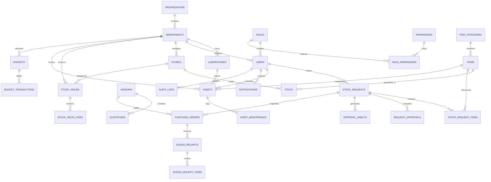
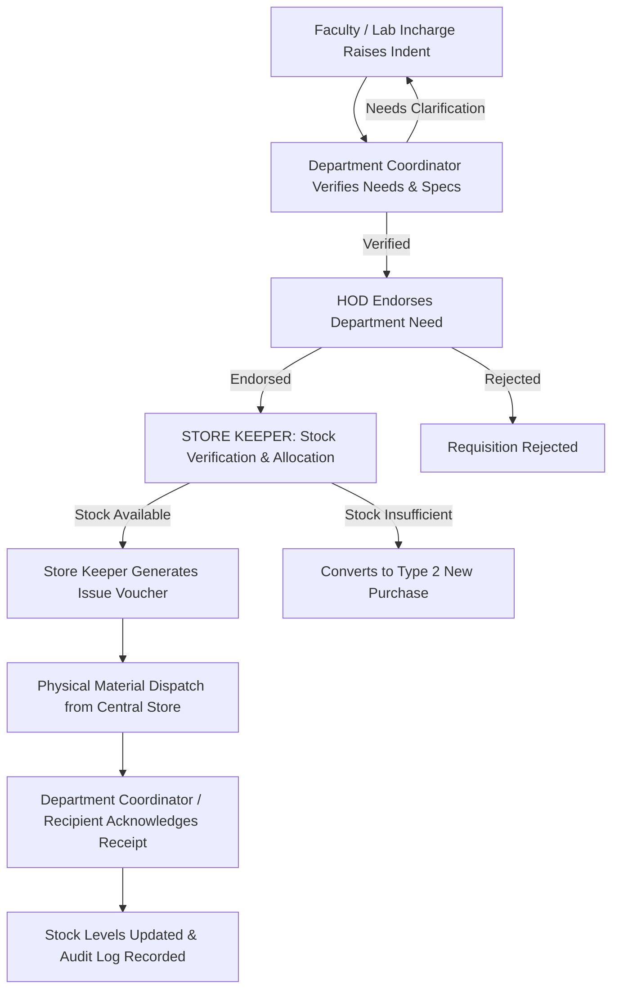
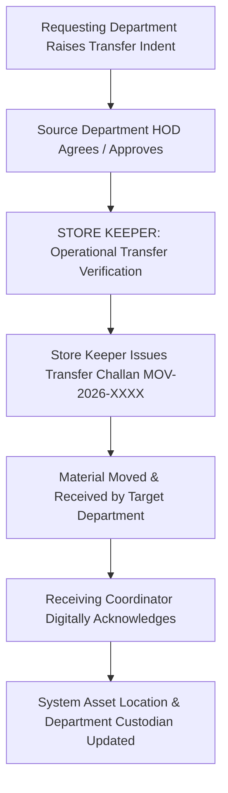

# MSEC SMART STOCK — Architecture Blueprint & Implementation Plan
**Smart Inventory, Asset & Distribution Management Portal**  
*Mohamed Sathak Engineering College (Autonomous), Kilakarai*

---

## 1. Specification Analysis & System Overview

The **MSEC SMART STOCK** portal is an enterprise-grade institutional resource planning, inventory control, and asset lifecycle management system for Mohamed Sathak Engineering College (MSEC). It replaces ad-hoc or fragmented spreadsheets and basic CRUD patterns with a strictly governed, role-segregated operational workflow.

### Core Institutional Pillars:
1. **Store Keeper as Central Operational Gateway**: The Store Keeper is never bypassed, even for low-value requests (e.g., ₹1). Every requisition follows the chain: `Requester → Department Coordinator → HOD → Store Keeper (Price, Spec, Vendor & Existing Stock Verification + Official Approval Sheet Generation) → VP / Principal Approval → Store Keeper (Purchase / Receipt / GRN / Asset Tagging / Issue Voucher / Dispatch) → Department Custody & Acknowledgment`.
2. **System-Admin Controlled Account & Security Management**:
   - Zero public self-registration.
   - Zero self-service password reset (no email OTP or public reset link).
   - Identity verification & password reset is strictly executed by System Admin and logged in the immutable audit trail.
   - Account locking, unlocking, role assignment, and session security are enforced at the backend level.
3. **14 Dedicated Role-Specific Dashboards**: Every single role (System Admin, Director, Principal, Vice Principal, Management Viewer, Store Keeper, Purchase Officer, Accounts Officer, HOD, Coordinator, Lab Incharge, Faculty, Technician, Auditor) receives a tailored workspace with unique KPIs, workflow action queues, tables, and reports.
4. **Institutional Auditability & Compliance**: Immutable audit logging for every state transition, stock adjustment, asset movement, and administrative change to satisfy NAAC Criteria 4 and NBA accreditation standards.

---

## 2. Proposed Directory & Module Architecture

We structure the codebase into a clean, maintainable MVC + Service pattern with modular controllers, dedicated role dashboard views, reusable UI components, and a database abstraction layer supporting both SQLite (zero-config local) and MariaDB/MySQL.

```
msec-smart-stock/
│
├── config/
│   ├── app.php                 # Core constants, institutional metadata, accreditation info
│   ├── database.php            # Database connections (SQLite & MySQL PDO configs)
│   ├── mail.php                # SMTP & notification delivery settings
│   └── settings.php            # Dynamic institutional settings loader
│
├── core/
│   ├── Database.php            # PDO Singleton with auto-driver detection & fallback
│   ├── Auth.php                # Authentication, session security, password hashing, role checks
│   ├── ApprovalEngine.php      # Workflow engine & multi-tier approval state machine
│   ├── AuditLogger.php         # Immutable ledger logger (action, before/after, IP, actor)
│   ├── Router.php              # Route dispatcher with RBAC middleware guards
│   └── View.php                # Layout & component template renderer
│
├── controllers/
│   ├── AuthController.php      # Login, session management, logout, admin password reset
│   ├── AdminController.php     # User management, role/permission mapping, security console, audit logs
│   ├── DashboardController.php  # Role-specific dashboard routing & KPI data aggregation
│   ├── InventoryController.php  # Stock catalog, bin locations, adjustments, low-stock alerts
│   ├── RequestController.php    # Requisitions, coordinator verification, HOD approval, store reviews
│   ├── ApprovalSheetController.php # Printable official approval sheet generation
│   ├── ProcurementController.php# Vendor master, quotations, comparative statements, POs, GRN
│   ├── DistributionController.php# Stock issue vouchers, gate passes, department acknowledgments
│   ├── MovementController.php   # Inter-department and lab-to-lab transfers with custody tracking
│   ├── AssetController.php      # Asset register, technical specs, MAC/IP, status lifecycle
│   ├── MaintenanceController.php# Service tickets, repairs, technician logs, condemnation
│   ├── BudgetController.php     # Departmental budget heads, commitments, expenditure tracking
│   ├── VerificationController.php# Periodic physical stock verification, discrepancy reports
│   └── ReportController.php     # Statutory NAAC/NBA, inventory, financial, & export reports (PDF/CSV/Print)
│
├── models/
│   ├── User.php                # User accounts, statuses, login attempts, roles
│   ├── Role.php                # Roles and granular module permission definitions
│   ├── Department.php          # Academic & administrative departments, HOD assignments
│   ├── Store.php               # Central and departmental store locations
│   ├── Laboratory.php          # Departmental laboratories & incharge mappings
│   ├── Inventory.php           # Catalog items, categories, subcategories, stock levels
│   ├── Request.php             # Requisitions, line items, status progression
│   ├── Approval.php            # Multi-level approval steps and remarks
│   ├── ApprovalSheet.php       # Official store keeper verification & approval sheets
│   ├── Vendor.php              # Vendor registry, ratings, quotations
│   ├── PurchaseOrder.php       # POs, terms, items, statuses
│   ├── GoodsReceipt.php        # GRN, physical count verification, invoice links
│   ├── Distribution.php        # Issue vouchers, delivery challans, receiver signatures
│   ├── Movement.php            # Transfers, transit statuses, custody handoffs
│   ├── Asset.php               # Asset master, hardware specs, warranty, custodians
│   ├── Maintenance.php         # Service tickets, repairs, breakdown costs
│   ├── Budget.php              # Annual budgets, ledger allocations, utilization
│   ├── Notification.php        # Role-targeted alerts & read states
│   ├── AuditLog.php            # Immutable transaction & security audit logs
│   └── Setting.php             # Configurable institutional policies & thresholds
│
├── views/
│   ├── layout/
│   │   ├── header.php          # Navigation bar, mobile hamburger, notification center, profile
│   │   ├── sidebar.php         # Role-adaptive dynamic sidebar with off-canvas drawer
│   │   └── footer.php          # Institution footer & scripts
│   │
│   ├── auth/
│   │   └── login.php           # Enterprise sign-in page with Admin contact security notice
│   │
│   ├── dashboards/             # 14 Role-Dedicated Workspaces:
│   │   ├── admin.php           # 01. System Admin (Security, Users, Audit, Config)
│   │   ├── director.php        # 02. Director (High-level KPIs, Capital Sanctions > 1L, Governance)
│   │   ├── principal.php       # 03. Principal (Institutional Sanctions > 25k, Budget Checks)
│   │   ├── vice_principal.php  # 04. Vice Principal (Admin Approvals > 5k, Inter-dept allocations)
│   │   ├── viewer.php          # 05. Management Viewer (Read-only analytics, overview)
│   │   ├── store_keeper.php    # 06. Store Keeper (Central Gateway, Verification, Approval Sheets, GRN, Issue)
│   │   ├── purchase_officer.php# 07. Purchase Officer (Vendors, Quotations, Comparative statements, POs)
│   │   ├── accounts_officer.php# 08. Accounts Officer (Budget Heads, Expenditure, Commitments)
│   │   ├── hod.php             # 09. HOD (Dept Requests, Quotas, Tier-1 Sanctions)
│   │   ├── coordinator.php     # 10. Dept Coordinator (Physical needs, spec checks, forwarding)
│   │   ├── lab_incharge.php    # 11. Lab Incharge (Lab inventory, consumable requests, damage reports)
│   │   ├── faculty.php         # 12. Faculty (Personal requests, assigned assets, acknowledgments)
│   │   ├── technician.php      # 13. Technician (Service tickets, repair bay, calibration)
│   │   └── auditor.php         # 14. Auditor (Stock discrepancies, audit evidence, immutable ledger)
│   │
│   ├── components/             # Reusable UI Components:
│   │   ├── kpi_card.php        # Metric cards with trend badges
│   │   ├── data_table.php      # Standardized responsive table container
│   │   ├── status_badge.php    # Standardized color-coded status badges
│   │   ├── timeline.php        # Visual multi-step approval workflow stepper
│   │   ├── modal.php           # Accessible modal dialogues
│   │   ├── notification_bell.php # Header notification dropdown
│   │   ├── empty_state.php     # Clean informative empty state with action
│   │   └── approval_sheet_template.php # Official printable A4 approval sheet with signatures
│   │
│   ├── admin/                  # User management, role permissions, audit trails, system settings
│   ├── inventory/              # Items, categories, stock adjustments, low stock warnings
│   ├── requests/               # Create indent, list, detail view with approval actions
│   ├── approval_sheets/        # Official approval sheet preview & printing
│   ├── procurement/            # Vendors, quotations, POs, GRN creation & review
│   ├── distribution/           # Issue vouchers, delivery challans, digital acknowledgement
│   ├── movement/               # Inter-dept and lab-to-lab transfers, custody handover
│   ├── assets/                 # Asset register, IT specs, barcode/QR tags, asset tracking
│   ├── maintenance/            # Service tickets, repair updates, condition tracking
│   ├── budget/                 # Department budget heads, allocations, utilization
│   ├── verification/           # Periodic physical verification, stock discrepancy logs
│   ├── reports/                # Report generation, filter panel, print & export views
│   └── errors/
│       ├── 403.php             # Unauthorized access error
│       └── 404.php             # Resource not found error
│
├── database/
│   ├── schema_mysql.sql        # Production MariaDB/MySQL 8.0 DDL script
│   ├── DatabaseSeeder.php      # Comprehensive SQLite & MySQL unified seeder
│   └── msec_stock.sqlite       # Local portable database file
│
├── public/
│   ├── css/
│   │   ├── style.css           # Core enterprise design system, CSS variables, utilities
│   │   ├── components.css      # Cards, tables, forms, badges, modals, stepper
│   │   └── print.css           # Print media stylesheet for vouchers and approval sheets
│   ├── js/
│   │   ├── app.js              # UI interactivity, drawer toggle, modal handlers, toast alerts
│   │   └── notifications.js    # Live notifications & polling helper
│   ├── images/
│   │   ├── msec_logo.png       # Mohamed Sathak Engineering College emblem
│   │   └── msec_letterhead.png # Official institutional letterhead banner
│   └── index.php               # Front controller & entrypoint
│
└── docs/
    └── UI_DOCUMENTATION.md     # Presentation guide with descriptions for all 14 role dashboards
```

---

## 3. Database ERD & Normalized Schema Design

The database schema is fully normalized and supports both SQLite and MySQL/MariaDB with proper constraints, foreign keys, and indexes.

### Table Categorization & Relationship Map:



### Table Definitions & Primary Columns:

1. **`users`**:
   - `id`, `username`, `password_hash`, `full_name`, `email`, `phone`, `employee_id`, `designation`, `role_key`, `dept_id`, `lab_id`, `status` (`Active`, `Inactive`, `Locked`), `failed_attempts`, `locked_until`, `last_login_at`, `last_login_ip`, `created_at`, `updated_at`.
2. **`roles` & `permissions` & `role_permissions`**:
   - `roles`: `id`, `role_key`, `name`, `level`, `description`.
   - `permissions`: `id`, `perm_key`, `module`, `description`.
   - `role_permissions`: `role_key`, `perm_key`.
3. **`organizations`, `departments`, `laboratories`, `locations`, `stores`**:
   - `departments`: `id`, `code`, `name`, `hod_user_id`, `created_at`.
   - `laboratories`: `id`, `dept_id`, `code`, `name`, `incharge_user_id`, `location`.
   - `stores`: `id`, `code`, `name`, `type` (`CENTRAL`, `DEPARTMENT`), `dept_id`, `keeper_user_id`.
4. **`item_categories`, `item_subcategories`, `units`, `items`, `stock`**:
   - `items`: `id`, `item_code`, `item_name`, `category_id`, `subcategory_id`, `unit_id`, `is_consumable`, `specification`, `manufacturer`, `model`, `min_stock`, `max_stock`, `unit_cost`, `description`.
   - `stock`: `id`, `store_id`, `item_id`, `available_quantity`, `reserved_quantity`, `store_location`, `last_movement_date`.
5. **`stock_requests`, `stock_request_items`, `request_approvals`, `approval_sheets`**:
   - `stock_requests`: `id`, `request_code`, `request_type` (`EXISTING_STOCK`, `NEW_PURCHASE`, `TRANSFER`), `dept_id`, `lab_id`, `requested_by`, `purpose`, `required_date`, `priority`, `total_estimated_value`, `current_level`, `status`, `created_at`.
   - `approval_sheets`: `id`, `sheet_number`, `request_id`, `store_keeper_id`, `existing_stock_notes`, `spec_verification_notes`, `vendor_id`, `quotation_ref`, `item_price`, `gst_percent`, `total_cost`, `recommendation`, `created_at`.
   - `request_approvals`: `id`, `request_id`, `level_number`, `level_title`, `approver_role`, `approver_user_id`, `status` (`Pending`, `Approved`, `Rejected`, `Returned`), `comments`, `action_date`.
6. **`vendors`, `quotations`, `purchase_orders`, `goods_receipts`, `goods_receipt_items`**:
   - `vendors`: `id`, `vendor_code`, `company_name`, `contact_person`, `mobile`, `email`, `address`, `gst_number`, `pan_number`, `bank_details`, `status`, `rating`.
   - `quotations`: `id`, `request_id`, `vendor_id`, `quote_reference`, `unit_price`, `tax_amount`, `total_amount`, `valid_until`, `doc_path`, `is_selected`.
   - `purchase_orders`: `id`, `po_number`, `request_id`, `vendor_id`, `total_amount`, `tax_amount`, `terms`, `status`, `created_by`, `created_at`.
   - `goods_receipts`: `id`, `grn_number`, `po_id`, `vendor_id`, `store_id`, `received_date`, `verified_by`, `invoice_no`, `invoice_date`, `remarks`.
7. **`stock_issues`, `stock_issue_items`, `department_receipts`**:
   - `stock_issues`: `id`, `issue_code`, `request_id`, `source_store_id`, `target_dept_id`, `target_lab_id`, `issued_by`, `recipient_id`, `issue_date`, `voucher_type`, `status`, `remarks`.
8. **`stock_movements`, `stock_movement_items`**:
   - `stock_movements`: `id`, `movement_code`, `movement_type`, `source_dept_id`, `target_dept_id`, `source_lab_id`, `target_lab_id`, `initiated_by`, `custodian_id`, `status`, `notes`.
9. **`assets`, `asset_maintenance`**:
   - `assets`: `id`, `asset_id`, `asset_tag`, `item_id`, `category_id`, `brand`, `model`, `serial_number`, `mac_address`, `ip_address`, `configuration`, `purchase_date`, `purchase_cost`, `warranty_expiry`, `dept_id`, `lab_id`, `location`, `custodian_id`, `asset_status`.
   - `asset_maintenance`: `id`, `asset_id`, `ticket_number`, `reported_by`, `issue_reported`, `technician_id`, `diagnosis`, `status`, `repair_cost`, `completed_date`.
10. **`budgets`, `budget_transactions`**:
    - `budgets`: `id`, `dept_id`, `budget_head_code`, `academic_year`, `category` (`CAPITAL`, `OPERATIONAL`), `allocated_amount`, `utilized_amount`, `committed_amount`.
11. **`notifications`, `audit_logs`, `system_settings`**:
    - `notifications`: `id`, `user_id`, `role_key`, `type`, `title`, `message`, `link_url`, `is_read`, `created_at`.
    - `audit_logs`: `id`, `user_id`, `role`, `action`, `module`, `entity_type`, `entity_id`, `old_values`, `new_values`, `remarks`, `ip_address`, `created_at`.
    - `system_settings`: `setting_key`, `setting_value`, `category`, `description`.

---

## 4. Comprehensive 14-Role RBAC & Permission Matrix

| Role | Hierarchy Level | Primary Operational Scope | Can Raise Indent | Can Approve Dept | Store Gate Review | Sanction Sanction | Purchase & PO | Issue Stock | Asset Maint | Audit / View |
|:---|:---|:---|:---:|:---:|:---:|:---:|:---:|:---:|:---:|:---:|
| **1. System Admin** | System Admin | Full technical, users, roles, password reset, security audit | No | No | No | No | No | No | No | Full Admin |
| **2. Director / Management** | Management | **Ultimate Financial Sanctioning Authority**, institutional oversight, capital/operating allocations | No | No | No | **All Sanctions** | View | View | View | Complete |
| **3. Principal** | Institution | Institutional academic review & recommendation, college head | No | No | No | Review & Recommend | View | View | View | Complete |
| **4. Vice Principal** | Administration | Administrative review & concurrence, inter-dept moves | No | No | No | Administrative Review | View | View | View | Complete |
| **5. Management Viewer**| Read Only | Board/Trust reporting, high-level dashboards, KPIs | No | No | No | No | View | View | View | Read Only |
| **6. Store Keeper** | Operational Gateway | Central gateway, price/spec check, approval sheet, GRN, issue | Yes (Store) | No | **Mandatory** | Operational Gate | View/GRN | **Yes** | Yes | Operations |
| **7. Purchase Officer** | Procurement | Vendor master, quotations, comparative statements, POs | No | No | No | No | **Yes** | No | No | Procurement |
| **8. Accounts Officer** | Finance | Budget verifications, allocations, payments, expenditures | No | No | No | Budget Check | Clearance | View | View | Financial |
| **9. HOD** | Department | Department head, verifies need, endorses dept indents (no independent financial sanction) | Yes | **Endorse** | No | Endorse Only | View | Acknowledge| View | Department |
| **10. Dept Coordinator** | Department | Technical check, spec verify, lab needs, gate-forward to HOD | Yes | Verify | No | No | No | Acknowledge| View | Department |
| **11. Lab Incharge** | Laboratory | Lab inventory, consumable needs, equipment faults | Yes | No | No | No | No | Acknowledge| Report | Lab Only |
| **12. Faculty** | User Level | Academic/project requirements, view personal requisitions | Yes | No | No | No | No | Acknowledge| Report | Personal |
| **13. Technician** | Maintenance | Tool crib, equipment repairs, service tickets, diagnostics | Yes | No | No | No | No | No | **Perform** | Service |
| **14. Auditor** | Oversight | Independent stock audit, physical verification, exceptions | No | No | No | No | View | View | View | **Audit Ledger**|

---

## 5. Request State Machine & Business Flows

### Workflow Type 1: Existing Stock Issue


### Workflow Type 2: New Purchase (Store Keeper Gatekeeper & Approval Sheet)

```mermaid
flowchart TD
    A[Faculty / Lab Assistant Raises Indent] --> B[Department Coordinator Verification]
    B --> C[HOD Department Endorsement]
    C --> D[STORE KEEPER OPERATIONAL GATEWAY]
    
    subgraph Store_Keeper_Review [Store Keeper Mandatory Verifications]
        D --> D1[1. Check Existing College-Wide Stock]
        D1 --> D2[2. Verify Technical Specifications]
        D2 --> D3[3. Verify Quotations & Exact Unit Price + GST]
        D3 --> D4[4. Verify Registered Vendors]
        D4 --> D5[5. Prepare Official Digital Approval Sheet]
    end
    
    D5 --> VP_AUTH[Vice Principal Administrative Concurrence]
    VP_AUTH --> PRIN_AUTH[Principal Institutional Academic Recommendation]
    PRIN_AUTH --> DIR_AUTH[Director / Management Final Financial Sanction]
    
    DIR_AUTH --> F[Accounts Officer Budget Head Verification]
    F --> G[Purchase Officer Issues Systematic PO PO-2026-XXXX]
    G --> H[Vendor Delivers Goods with Invoice & Challan]
    H --> I[STORE KEEPER: Physical Inspection & GRN GRN-2026-XXXX]
    I --> J[Store Keeper Registers Catalog Items & Serialized Assets]
    J --> K[Store Keeper Dispatches Issue Voucher to Department]
    K --> L[Department Acknowledgment & Custody Transfer]
    L --> M[Immutable Audit Trail Finalized]
```


### Workflow Type 3: Inter-Department Transfer


### Request Lifecycle States:
- `DRAFT`: Requester editing line items.
- `SUBMITTED`: Formally submitted by faculty/staff.
- `COORDINATOR_REVIEW`: Awaiting Dept Coordinator verification.
- `COORDINATOR_VERIFIED`: Coordinator confirmed specs and lab necessity.
- `HOD_REVIEW`: In Department Head queue.
- `HOD_APPROVED`: Department authorized; pushed to Store.
- `STORE_REVIEW`: Under Store Keeper operational inspection.
- `STORE_VERIFIED`: Store confirmed existing stock, prices, quotes, and generated Approval Sheet.
- `MANAGEMENT_APPROVAL`: Queued for VP / Principal / Director based on threshold.
- `APPROVED`: Fully sanctioned by highest required authority.
- `REJECTED`: Formally rejected with mandatory remarks.
- `RETURNED`: Returned to previous step for clarification.
- `PURCHASE_PENDING`: In Purchase Officer queue for PO generation.
- `PO_CREATED`: PO issued to vendor.
- `RECEIVED`: Goods physically arrived at central receiving bay.
- `GRN_CREATED`: Store Keeper generated GRN, verified accepted vs rejected qty.
- `REGISTERED`: Asset tag numbers generated and catalog updated.
- `ISSUED`: Issue voucher dispatched to department.
- `COMPLETED`: Department acknowledged receipt; closed.
- `CANCELLED`: Cancelled by administrator.

---

## 6. Full Catalog of 14 Role-Specific Dashboards

Each role will have its own dedicated view file in `views/dashboards/`:

1. **System Admin (`views/dashboards/admin.php`)**:
   - KPIs: Active Users, Locked Accounts, Disabled Accounts, Password Reset Requests, Failed Logins (24h).
   - Sections: Quick User Creator, Account Status Ledger, Security Events Monitor, Live Audit Stream, System Config Summary.
2. **Director (`views/dashboards/director.php`)**:
   - KPIs: Total Institutional Inventory Value (₹), Capital Assets Count, Pending Sanctions > ₹1L, Annual Budget Utilization (%), Dead Stock Value.
   - Sections: Major Procurement Approvals Queue, Multi-Department Expenditure Breakdown, Accreditation Compliance Tracker, Recent Sanctions.
3. **Principal (`views/dashboards/principal.php`)**:
   - KPIs: High-Value Requisitions Pending (> ₹25k), Store-Verified Approvals, Active Department Allocations, Annual Budget Surplus/Deficit.
   - Sections: Institutional Approval Queue, High-Value Line Items Review, Department Purchase Activity, Audit Exception Summaries.
4. **Vice Principal (`views/dashboards/vice_principal.php`)**:
   - KPIs: Administrative Approvals Pending (₹5k - ₹25k), Inter-Department Transfers in Queue, Department Low Stock Warnings, Today's Receipts.
   - Sections: Administrative Sanctions Queue, Inter-Department Material Movements, Department Stock Health, Decision Log.
5. **Management Viewer (`views/dashboards/viewer.php`)**:
   - KPIs: Total Campus Stock Valuation, Department Stock Distribution, Asset Breakdown (IT/Lab/Civil/Mech), Accreditation Ratio (PCs per Student).
   - Sections: Read-Only Executive Analytics, Capital Expenditure Charts, Statutory NAAC/NBA Metrics, Audit Summary.
6. **Store Keeper (`views/dashboards/store_keeper.php`) — Central Operational Gateway**:
   - KPIs: Pending Indents Awaiting Store Verification, Approval Sheets to Prepare, Pending Issue Vouchers, Pending GRNs, Low-Stock Buffer Alerts.
   - Sections:
     * A. Store Review Queue (Incoming from HODs)
     * B. Stock Verification & Approval Sheet Generator
     * C. Goods Receipt Note (GRN) Processing Bay
     * D. Issue Stock & Voucher Dispatch
     * E. Inter-Department Transfer Control
     * F. Low-Stock & Buffer Reorder Monitor
7. **Purchase Officer (`views/dashboards/purchase_officer.php`)**:
   - KPIs: Active Purchase Indents, Open POs, Registered Vendors, Quotations Awaiting Comparison, Procurement Pipeline Value (₹).
   - Sections: Purchase Pipeline, Quotation Comparative Statement Builder, Vendor Performance Roster, Recent PO Status.
8. **Accounts Officer (`views/dashboards/accounts_officer.php`)**:
   - KPIs: Institutional Budget Total, Utilized Amount, Committed Expenditure, Available Balance, Pending Financial Sanctions.
   - Sections: Department Budget Head Ledger, Financial Clearance Queue, PO Payment Authorizations, Expenditure Trends.
9. **HOD (`views/dashboards/hod.php`)**:
   - KPIs: Department Pending Requests, Department Stock Valuation (₹), Allocated Assets, Department Budget Remaining.
   - Sections: Department Requisitions Approval Queue, Department Lab Assets, Low-Stock Lab Consumables, Recent Issues.
10. **Department Coordinator (`views/dashboards/coordinator.php`)**:
    - KPIs: New Requisitions Awaiting Inspection, Verified & Forwarded, Pending Delivery Acknowledgments, Transfers in Transit.
    - Sections: Requirement Inspection Queue, Delivery Challan Acknowledgment Box, Lab Needs Overview, Department Transfer Requests.
11. **Lab Incharge (`views/dashboards/lab_incharge.php`)**:
    - KPIs: Lab Assets Count, Working Equipment, Equipment Under Repair, Low Consumables in Lab.
    - Sections: Lab Equipment Inventory, Raise Lab Consumable Requisition, Report Equipment Damage / Breakdown, Received Stock.
12. **Faculty (`views/dashboards/faculty.php`)**:
    - KPIs: My Raised Indents, Approved & Ready for Pickup, Assigned Computing Equipment, Pending Acknowledgments.
    - Sections: Quick Requisition Raiser, My Requisitions Tracker, Assigned Hardware & Office Equipment, Damage Report Form.
13. **Technician (`views/dashboards/technician.php`)**:
    - KPIs: Active Service Tickets, Equipment Under Maintenance, Calibration Due This Month, Repaired Equipment.
    - Sections: Service Ticket Queue, Diagnosis & Repair Action Form, Spare Parts Usage, Asset Maintenance History.
14. **Auditor (`views/dashboards/auditor.php`)**:
    - KPIs: Physical Stock Discrepancies, Unacknowledged Vouchers > 7 Days, Dead Stock Items (> 2 yrs), Missing Evidence Flags.
    - Sections: Stock Verification Exceptions Ledger, Permanent Immutable Audit Log, Document Completeness Check, Statutory Export.

---

## 7. Login Page & Account Management Security Architecture

### Strict Security Flow:
1. **Login Page (`views/auth/login.php`)**:
   - Enterprise institutional aesthetic with MSEC banner, accreditation badges (NAAC A+, NBA).
   - Username/Employee ID and Password fields with "Show Password" toggle.
   - **Prominent Policy Notice**:
     > 🔒 **Institutional Account Policy**:  
     > Self-registration is disabled. Forgot your password? Please contact the **System Administrator** to verify your identity and receive a reset credential.
   - **No self-service registration or public reset link.**
2. **System Admin Account Management (`views/admin/users.php`)**:
   - Create User Modal (Employee ID, Username, Full Name, Email, Phone, Role, Department, Lab, Designation, Initial Password).
   - Account Actions:
     * **Activate / Deactivate Account**: Toggles active status.
     * **Lock / Unlock Account**: Unlocks locked accounts or locks suspicious accounts.
     * **Reset Password**: System Admin generates or sets a new secure password. System records `PASSWORD_RESET_BY_ADMIN` in the immutable audit log.
     * **Change Role / Department**: System Admin updates role and logs `ROLE_CHANGED`.
3. **Session & Password Security**:
   - Passwords hashed using standard PHP `password_hash($pass, PASSWORD_BCRYPT)`.
   - Bruteforce protection: Track failed login attempts; lock account after 5 consecutive failures.
   - Session regeneration on login (`session_regenerate_id(true)`) to prevent session fixation.
   - Role-based redirection after login to the user's specific dashboard.

---

## 8. Open Questions & Items Requiring Confirmation

> [!NOTE]
> The following parameters have sane default configurations built in, but can be customized based on institutional preference:

1. **Email/SMTP Credentials**: Automated notifications are configured with standard templates. Should the system connect to Google Workspace (`smtp.gmail.com`) or an on-premise college mail server? *(Defaults to internal logging if SMTP is unconfigured)*.
2. **Institutional Sanction Hierarchy**: Configured per MSEC governance: HOD provides departmental endorsement, Vice Principal provides administrative concurrence, Principal provides academic recommendation, and Management (Directorate) grants final financial sanction for all procurements.
3. **Database Choice**: The system operates with zero-config SQLite portable file and seamless switchover to MySQL/MariaDB via `config/database.php`.

---

## 9. Phased Implementation Plan

- [ ] **Phase 1: Architecture & Security Core**:
  - Update `core/Auth.php` with locked account detection, failed login counting, System Admin password reset, and strict backend permission enforcement.
  - Create `core/AuditLogger.php` for comprehensive transaction logging.
  - Update `views/auth/login.php` with enterprise aesthetic, institutional security notice, and removal of any auto-login or self-service reset.
- [ ] **Phase 2: Database Schema & Seeder Enhancement**:
  - Ensure all tables (`users`, `roles`, `permissions`, `approval_sheets`, `quotations`, `budgets`, `notifications`, `audit_logs`) are fully defined in `database/DatabaseSeeder.php` and `schema_mysql.sql`.
  - Seed baseline users for all 14 roles with secure password hashes.
- [ ] **Phase 3: System Admin Workspace & Security Console**:
  - Implement full user management in `views/admin/users.php` (Create, Edit, Lock, Unlock, Activate, Deactivate, Reset Password, Role Assign).
  - Implement security monitoring and audit log views.
- [ ] **Phase 4: Store Keeper Central Gateway & Approval Sheet**:
  - Build the Store Keeper dashboard (`views/dashboards/store_keeper.php`) as the central operational hub.
  - Implement the official printable Approval Sheet template (`views/approval_sheets/view.php`) with verification checklist and signature blocks.
- [ ] **Phase 5: The 13 Other Dedicated Dashboards**:
  - Implement Director, Principal, Vice Principal, Management Viewer, Purchase Officer, Accounts Officer, HOD, Coordinator, Lab Incharge, Faculty, Technician, and Auditor dashboards with role-specific KPIs, queues, and tables.
- [ ] **Phase 6: Requisition, Approval, & Procurement Modules**:
  - Implement Request creation, Coordinator verification, HOD approval, and multi-tier approval actions.
  - Implement Purchase Orders, Vendor management, and Goods Receipt Notes (GRN).
- [ ] **Phase 7: Asset Register, Maintenance & Transfers**:
  - Implement serialized Asset tracking, IT specs (MAC, IP), and technician maintenance tickets.
  - Implement inter-department stock transfers with custody tracking.
- [ ] **Phase 8: Notifications, Reports & Verification**:
  - Implement header notification center dropdown.
  - Implement statutory NAAC/NBA and stock verification discrepancy reports.
  - Verify mobile responsiveness, print styling, and audit integrity.
